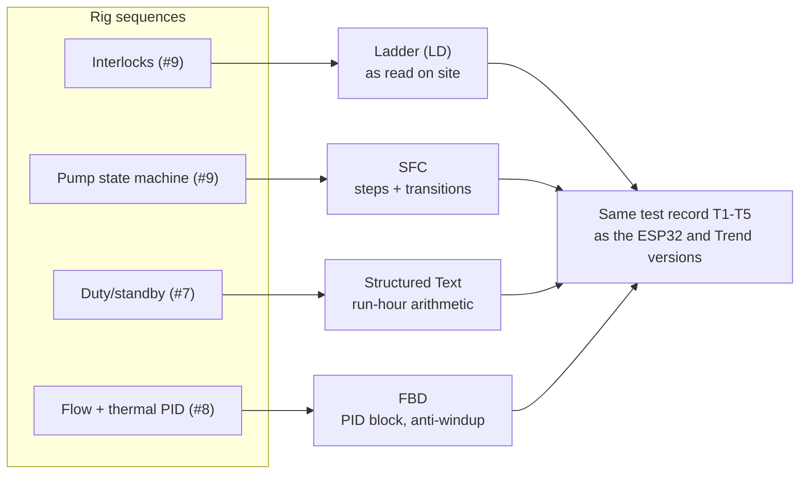

# PLC Re-implementation: The Rig's Logic in All Four IEC 61131-3 Languages (Design Stage)

**The training rig's sequences (interlocks, pump state machine, duty/standby rotation and PID loops) re-implemented on PLC platforms, deliberately using a different IEC 61131-3 language for each job: Ladder, Sequential Function Chart, Structured Text and Function Block Diagram. Then compared with the same logic on ESPHome and on a Trend IQ411 BMS controller, so the portfolio shows one set of logic on three kinds of controller.**

> **The short version:**
> - **Ladder (LD):** pump permissives and interlocks, as they're drawn and read on site.
> - **SFC:** the pump state machine (OFF → START → PROVING → RUN → FAULT → LOCKOUT).
> - **Structured Text (ST):** duty/standby with run-hour balancing and failover.
> - **FBD:** the PID flow and thermal loops with the standard PID block and anti-windup.
> - **Platforms:** CODESYS (soft PLC + WebVisu HMI) and Siemens TIA Portal + PLCSIM; optionally a secondhand small PLC to drive the rig's real pumps.
> - **Comms:** reads the ESP32 Modbus server's register map; **tests** reuse the rig test records; **code** is exported as PLCopen XML into Git.

**Portfolio position:** Field/automation level · controller programming (portfolio #13). Same logic as: [duty/standby + interlocks](https://github.com/the-control-cabinet/din-rail-rig-duty-standby-interlocks) (#7/#9) · [PID rig](https://github.com/the-control-cabinet/pid-anti-hunt-control-rig) (#8). Compared with: [Trend IQ411](https://github.com/the-control-cabinet/trend-iq411-commissioning) (#12). Comms: [ESP32 Modbus server](https://github.com/the-control-cabinet/esp32-modbus-server-plant-points)

---

## Status at a glance

| Item | Status |
|---|---|
| Program structure by language | 📐 Designed ([doc 01](docs/01-programs.md)) |
| Platforms and test approach | 📐 Designed ([doc 02](docs/02-platforms-and-testing.md)) |
| Three-platform comparison framework | 📐 Drafted ([doc 03](docs/03-three-platform-comparison.md)); results after the build |
| Tag list | 🚧 Started ([data/tag-list.csv](data/tag-list.csv)) |
| Source sequences (duty/standby, interlocks, PID) | 📐 Designed on the [rig](https://github.com/the-control-cabinet/din-rail-rig-duty-standby-interlocks) |
| CODESYS build, TIA Portal + PLCSIM, Modbus client, WebVisu | ⏳ To do |

## Why re-implement in a PLC

BMS and PLC work overlap more every year: packaged plant (chillers, AHUs, boilers) runs on PLCs, and many controls engineers move between the two. IEC 61131-3 defines the five PLC languages; four of them suit different parts of the same problem, so the rig's logic is split across them deliberately, each where it's the natural choice.

## One problem, four languages

| Program | Language | Content |
|---|---|---|
| `Interlocks` | **LD** | Low-level permissive, hand/off/auto, lockout latch with reset, pilot lights |
| `PumpStateMachine` | **SFC** | OFF / START / PROVING / RUN / FAULT / LOCKOUT; transitions on demand, proof, timers |
| `DutyStandby` | **ST** | Lead selection by run hours, weekly rotation, failover, idle-pump exercise |
| `FlowLoop`, `ThermalLoop` | **FBD** | Standard PID block, output limits, anti-windup, bumpless manual/auto transfer |
| `Alarms` | ST / FBD | Latching, acknowledgement, priority per the [alarm strategy](https://github.com/the-control-cabinet/alarm-and-trend-strategy) |
| `ModbusIO` | Configuration | Modbus client reading the [ESP32 register map](https://github.com/the-control-cabinet/esp32-modbus-server-plant-points) |

## Tag list (start)

| Tag | Type | Address | Description | Program |
|---|---|---|---|---|
| `DI_LowLevelOK` | BOOL | %IX0.0 | Low-level float OK | Interlocks |
| `DI_FlowProven` | BOOL | %IX0.1 | Flow proving input | PumpStateMachine |
| `DO_PumpA` | BOOL | %QX0.0 | Pump A run | DutyStandby |
| `DO_PumpB` | BOOL | %QX0.1 | Pump B run | DutyStandby |

**Conventions:** a tag list (I/O, internal, HMI) with naming rules; one program per function; a comment on every network and step; constants for every setpoint and timer.

## Platforms

| Platform | Use |
|---|---|
| **CODESYS** | All four languages, soft PLC, WebVisu HMI page, Modbus client |
| **Siemens TIA Portal + PLCSIM** | The interlocks and state machine again, in the Siemens environment |
| Optional hardware | A small secondhand PLC (LOGO! 8 or S7-1200) driving the rig's real pumps |

## The comparison it completes

| Aspect | ESPHome (ESP32) | Trend IQ411 | IEC 61131-3 PLC |
|---|---|---|---|
| Programming model | YAML + C++ lambdas | Strategy modules in SET | LD / SFC / ST / FBD |
| State machines | Hand-coded | Logic + latches | SFC: native |
| PID | PID climate | Loop module | PID function block |
| Diagnostics | Logs, HA history | SET monitoring | Online monitoring, forcing, trace |
| Change control | Git (YAML) | Strategy files | PLCopen XML in Git |

Results (engineering hours, blocks or lines, test pass rates, observations) are filled in after each build.

## Change control

PLCopen XML exports committed per change, with screenshots of each network and step for readers without the software.

## Documents

| Doc | Contents |
|---|---|
| [01 Programs and languages](docs/01-programs.md) | What is written in which language, and why |
| [02 Platforms and testing](docs/02-platforms-and-testing.md) | CODESYS, TIA Portal, optional hardware; simulation and tests |
| [03 Three-platform comparison](docs/03-three-platform-comparison.md) | ESPHome vs Trend IQ411 vs IEC PLC |

## Roadmap
- [ ] Tag list and conventions
- [ ] CODESYS: interlocks (LD) and state machine (SFC) in simulation
- [ ] Duty/standby (ST) and PID loops (FBD)
- [ ] WebVisu HMI page and Modbus client to the ESP32
- [ ] TIA Portal + PLCSIM re-implementation
- [ ] Three-platform comparison completed with results

## Skills demonstrated (as built)
| Skill | Evidence |
|---|---|
| PLC programming | All four IEC 61131-3 languages, each used for its natural job |
| Structured design | Tag list, conventions, one program per function |
| Testing | Simulated I/O against a shared test record |
| Platform breadth | Same logic on ESPHome, Trend and PLC compared |
| Comms | Modbus client to a field device |

📺 [The Control Cabinet on YouTube](https://www.youtube.com/channel/UC5Cupmz7vlfcodpCX7k8iuQ)

*Built and documented by James · part of [The Control Cabinet BMS portfolio](https://github.com/the-control-cabinet/the-control-cabinet). MIT Licence.*
